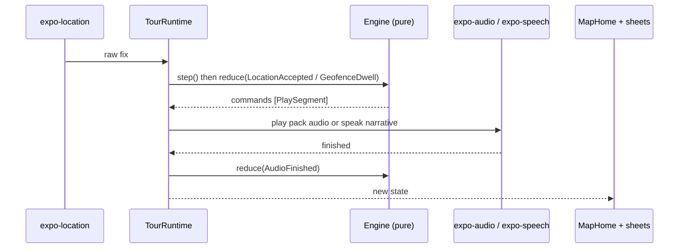

# App Runtime

The app is a single map screen with bottom sheets. There is no navigator.

## Wiring

All side effects live in `packages/ui/src/wiring/`.

| File                          | Job                                                                                                                 |
| ----------------------------- | ------------------------------------------------------------------------------------------------------------------- |
| `useTourEngine.ts`            | React hook that owns engine state and exposes it to `App.tsx`                                                       |
| `TourRuntime.ts`              | Executes engine commands: plays audio, speaks TTS, schedules timers, changes location mode                          |
| `locationAdapter.ts`          | `expo-location` foreground watch, plus background updates through `backgroundLocationTask.ts` (`expo-task-manager`) |
| `locationPowerPolicy.ts`      | Picks GPS accuracy/interval per tour phase                                                                          |
| `ExpoAudioPlaybackAdapter.ts` | Plays pre-rendered AAC from the pack with `expo-audio`                                                              |
| `audioSession.ts`             | Audio session category, interruptions, focus events                                                                 |
| `usePackManager.ts`           | Finds, verifies and loads packs. `AUTO_BOOTSTRAP_CONTENT` in `featureFlags.ts` loads the bundled Warsaw pack        |

## Background operation

- iOS: `UIBackgroundModes` `audio`, `location`, `fetch` in `app.config.ts`.
- Android: foreground service from `plugins/withTramioForegroundService.js`.
- `expo-keep-awake` while the app is in the foreground.

## UI shell

- `packages/ui/src/shell/MapHome.tsx` holds one persistent `OfflineMap`. Modes are Explore, Riding and Review (`shell/mapMode.ts`).
- `shell/SheetHost.tsx` hosts sheets with peek, mid and full detents (`sheetDetents.ts`). `phaseRouting.ts` picks the sheet from the engine phase.
- Sheets: `RouteLibrarySheet` (idle), `NearbySheet`, `NowPlayingSheet` (riding), `PoiDetailSheet`, `TourSummarySheet` (ended), `DeviationSheet` (never shown today).
- `StatusPill` shows GPS, background and boarding status.

## Map

- `packages/map/src/OfflineMap.tsx` uses `@maplibre/maplibre-react-native`.
- `tileSource.ts` points a vector source at `file://.../packs/{bundleId}/{version}/tiles/{z}/{x}/{y}.pbf`.
- `layers.ts` draws the route line, POI dots by state (upcoming, next, playing, pending, consumed), selection ring and rider dot.
- OpenStreetMap attribution is always visible.
