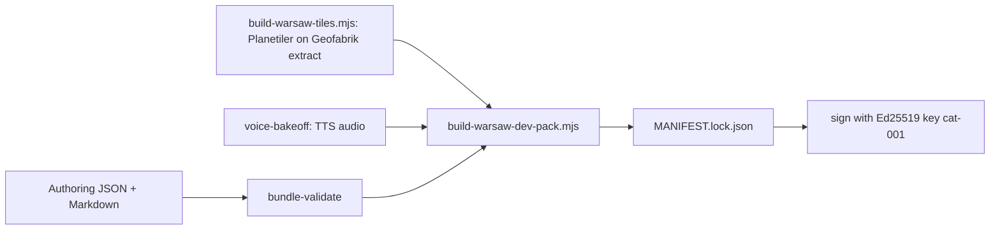

# Content Packs

A pack is everything one route needs for an offline ride.

## Layout

```text
packages/backend/data/packs/<bundleId>/<version>/
  manifest.json          bundle identity, languages, metadata
  route.json             stops and route geometry
  pois.json              points of interest, priority, dwell, geofence
  narratives/            poi-<id>.<lang>.md (Markdown + frontmatter with claims and review)
  audio/                 pre-rendered .m4a per POI and language
  tiles/                 z/x/y.pbf vector tiles
  MANIFEST.lock.json     every asset with sha256, size, protected flag
  MANIFEST.lock.sig      { signature, kid } Ed25519 over canonical JSON of the lock
```

The reference pack is `warsaw-bus-180-north@1.0.0` (Warsaw bus 180, northbound).

## Build pipeline



| Script                                             | Job                                                           |
| -------------------------------------------------- | ------------------------------------------------------------- |
| `npm run pack:build-warsaw-tiles`                  | Planetiler on an OSM extract, exploded to `.pbf` tiles        |
| `npm run pack:build-warsaw`                        | Assemble pack, optionally bake audio, write and sign the lock |
| `npm run validate:packs` / `validate:packs:strict` | Run `bundle-validate` over every pack                         |
| `npm run narration:audit`                          | Word budget and tone checks                                   |
| `npm run keys:generate-dev`                        | Generate a dev catalog signing key                            |

## Validation levels

`packages/authoring/bin/bundle-validate.js [--strict] [--release] <dir>`

| Level       | Checks                                                                                                      |
| ----------- | ----------------------------------------------------------------------------------------------------------- |
| default     | Ajv schemas, cross-file invariants, bundle identity, no refuted claims, confirmed claims have a `sourceUrl` |
| `--strict`  | Every narrative has an approved review, no `unchecked` or `unverifiable` claims                             |
| `--release` | Every stop has `gtfsStopId` and `scheduledOffsetSec`                                                        |

The claim and review fields exist because AI-drafted narration can contain plausible but wrong facts. See `packages/authoring/AUTHORING.md`.

## Signing and verification

- **Sign**: `tooling/build-warsaw-dev-pack.mjs` signs the lock with the dev key in `fixtures/dev/catalog-signing-key.json` (gitignored).
- **Pin**: `packages/clients/src/catalogPublicKey.ts` embeds the public key from `fixtures/dev/catalog-public-key.json`.
- **Verify**: `packages/storage/src/packLoader.ts` checks the signature, bundle identity, then SHA-256 and size of every asset. Any failure is a typed `PackIntegrityError`. Nothing loads on failure.
