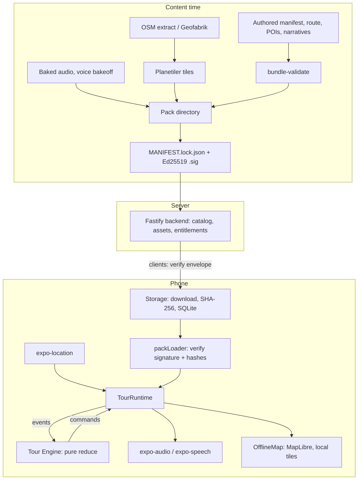

# System Overview

Tramio has two distinct lifecycles:

- **Content time**: authors build, validate and sign a route pack. Happens on a dev machine or CI.
- **Ride time**: the phone loads a verified pack and the engine decides what to play while the vehicle moves. Happens offline.

## Data flow

## Packages

| Package                   | Role                                                                 | State                      |
| ------------------------- | -------------------------------------------------------------------- | -------------------------- |
| `packages/engine`         | Pure tour state machine and GPS pipeline                             | Wired                      |
| `packages/ui`             | Map-first app shell, sheets, runtime wiring (`wiring/`)              | Wired                      |
| `packages/map`            | `OfflineMap` on MapLibre, local `.pbf` tiles, overlay layers         | Wired                      |
| `packages/storage`        | Pack loader, downloader, integrity checks, SQLite schema, LRU budget | Wired                      |
| `packages/clients`        | Catalog and entitlement HTTP clients, in-tour network guard          | Wired (dev backend)        |
| `packages/authoring`      | Bundle schema (Ajv) and `bundle-validate` CLI                        | Wired (content time)       |
| `packages/backend`        | Fastify catalog, asset, GTFS, entitlement, moderation routes         | Dev only, in-memory        |
| `packages/simulator`      | Deterministic GPS trace replay through the real engine               | Wired (dev/CI)             |
| `packages/branding`       | Display name, scheme, bundle IDs                                     | Wired                      |
| `packages/capability`     | OS capability matrix and probes                                      | Built, not used at runtime |
| `packages/native`         | Custom turbo modules for location, audio, TTS                        | Built, not linked          |
| `packages/crypto-service` | Planned key handling and AES-GCM                                     | Empty stub                 |

## Root app

- `App.tsx` composes `ThemeProvider` and `MapHome`, and drives the engine through `useTourEngine()`.
- `app.config.ts` declares background modes (`audio`, `location`, `fetch`) and permissions.
- `plugins/withTramioForegroundService.js` adds the Android foreground service for background location.
- `ios/` and `android/` are generated by `expo prebuild`.

## Design rules

1. **The engine has no I/O.** It never touches React Native, the filesystem or the network. Side effects happen only in `packages/ui/src/wiring/`, which executes the engine's commands.
2. **No network during a tour.** `packages/clients/src/http-client.ts` throws `TourActiveBlockError` for any non-loopback request while a tour is active.
3. **Nothing plays unless verified.** Packs must pass signature and per-asset SHA-256 checks before load.
4. **Offline map.** Tiles are served from `file://` inside the pack. No commercial tile provider.
