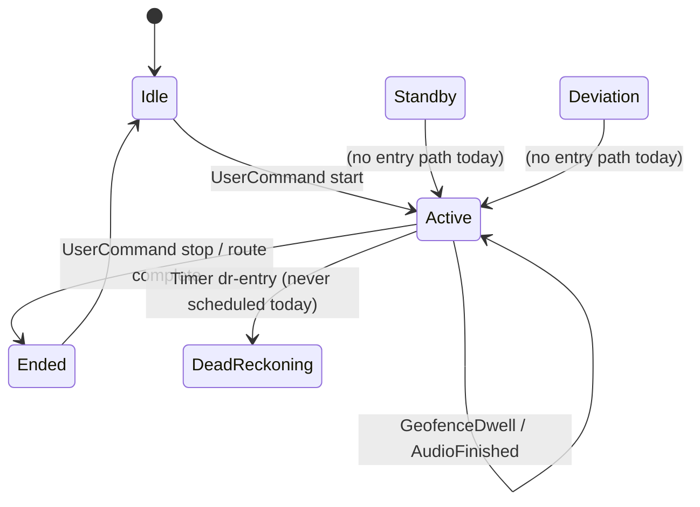

# Tour Engine

`packages/engine` is a pure reducer. Same events in, same commands out, every time. This is what makes the simulator and property tests possible.

## API

```ts
reduce(state, event, now, config?) => { state, commands }   // engine/src/reducer.ts
step(pipelineState, rawFix, ts)     => pipeline result       // engine/src/pipeline/pipeline.ts
```

- **Events** (`engine/src/events.ts`): `LocationAccepted`, `LocationRejected`, `Timer`, `EntitlementsChanged`, `UserCommand`, `AudioFinished`, `FocusLoss`, `FocusRegain`, `GeofenceEnter`, `GeofenceDwell`, `GeofenceExit`.
- **Commands** (`engine/src/commands.ts`): `PlaySegment`, `RequestDecryptedSegment`, `StopAudio`, `PauseAudio`, `ResumeAudio`, `RequestLocationMode`, `ScheduleTimer`, `CancelTimer`, `ShowDeviationPrompt`, `HideDeviationPrompt`, `ReleaseAll`, and others.
- **State** (`engine/src/state.ts`): `Idle | Active | Standby | DeadReckoning | Deviation | Ended`. Non-idle states share a `TourSession` with geofences, the consumed set, a FIFO of pending POIs, the playing segment, entitlements and the media catalog.

## State machine



Only `Idle`, `Active` and `Ended` are reachable in production today. See [Status and Known Gaps](Status-and-Known-Gaps.md).

## GPS pipeline

Each raw fix passes through `step()` in order:

1. **Accuracy gate**: reject fixes with accuracy worse than 50 m.
2. **Spike filter**: reject jumps implying more than 120 km/h.
3. **Smoothing**: mean of the last 3 fixes. (The file header still says EMA. It is a simple moving average.)
4. **Projection**: snap onto the route polyline.
5. **Dwell accumulator**: per POI. A POI must stay in the candidate set for its dwell time. Dropping out resets it.
6. **Direction filter**: route tangent vs heading. Currently disabled in the Warsaw config.

A dwell completion becomes a `GeofenceDwell` event for the reducer.

## Dispatch rules

- **Priority** (`engine/src/priority.ts`): when several POIs fire together, highest priority wins. Ties go to the lower author index. Losers are marked consumed.
- **Queueing**: if audio is already playing, the new POI goes into `pendingPoiIds` and plays after `AudioFinished`.
- **Unavailable content**: consumed silently, never blocks the queue.
- **Focus**: loss pauses audio. Regain within 10 minutes resumes. Later than that, the segment stops and the POI is consumed.

## Audio source selection

`engine/src/audioSource.ts` falls back in order: pre-rendered audio in the selected language, narrative text (TTS) in the selected language, then the pack's default language, then any language, then "unavailable".
